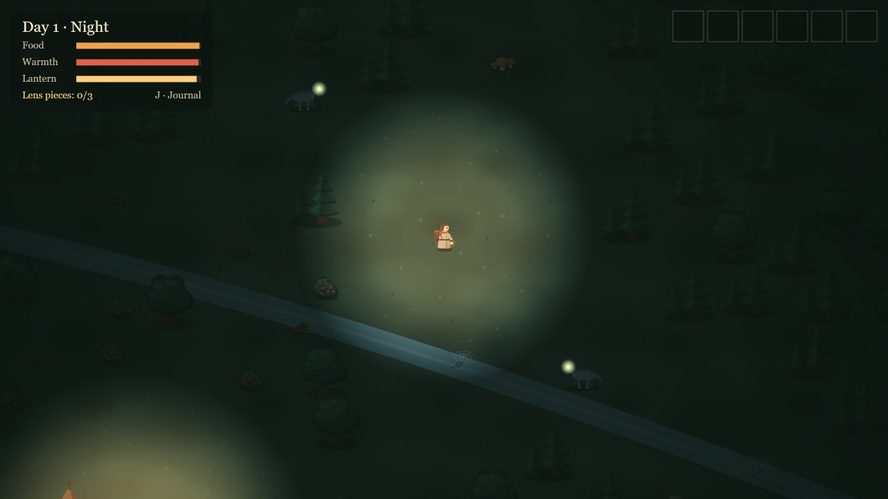
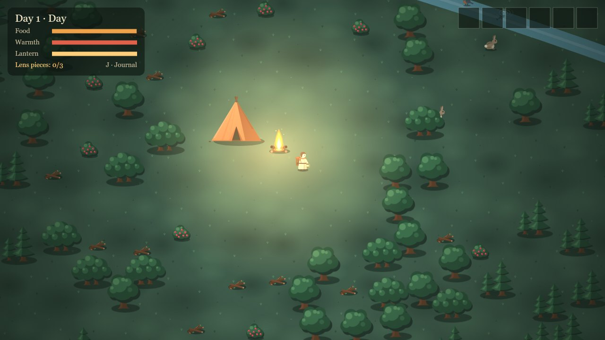
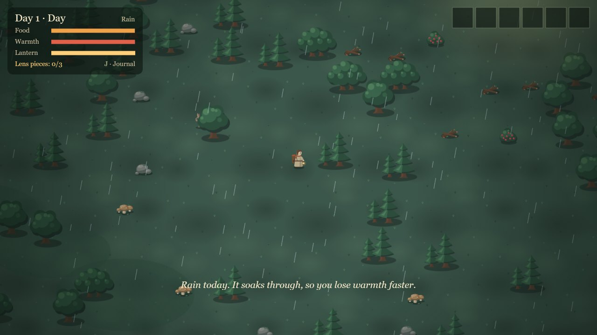
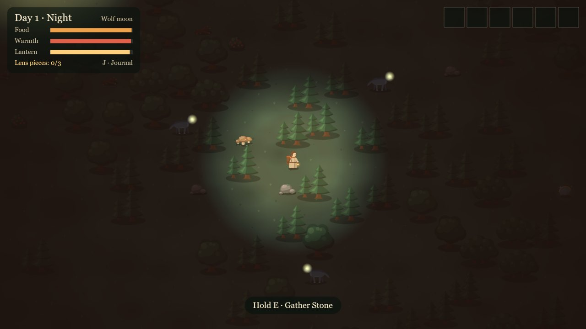
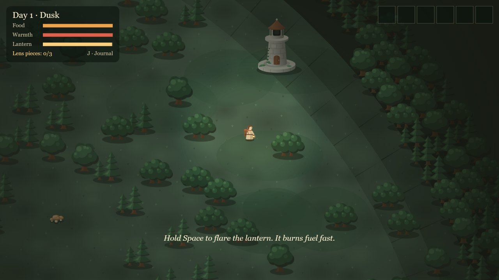

<p align="center">
  <a href="https://hamdanesmail.github.io/keepers-lantern/">
    
  </a>
</p>

<p align="center">
  <a href="https://hamdanesmail.github.io/keepers-lantern/"></a>
</p>

<p align="center">
  <i>A quiet survival game about a lantern, a forest that won't sit still, and a beacon that went dark.</i><br>
  Made for <b>Hack Club Terra</b>, Week 1: <i>"Outside!"</i>
</p>

<p align="center"></p>

## The story so far

> My father kept the beacon for forty years. While it burned, the woods stayed where they were.
>
> Last winter he walked into the deep woods and didn't come back. The beacon went dark that same night.
>
> Now the forest moves. Every morning the paths are somewhere new.
>
> His lantern still hangs by the tent. It still has oil.

You are the keeper's child. Each morning you leave camp with his old lantern and an empty pack. You gather what you can, and you get home before the night and the wolves close in. What you bring back mends his old gear, so tomorrow you can go a little further.

Somewhere in the deep woods are the three pieces of the beacon's lens, and pages from his journal. What they say is for you to find.

## A day in the valley

<p align="center"></p>

- **Food** drains as you go. Berries, fish and cooked meals fill it back up.
- **Warmth** drains faster at night, in the rain, and away from the fire.
- **The lantern** burns oil. As it runs low, its light shrinks.
- **The wolves** come at night. They keep to the edge of your light and close in as it fades. They are the forest's guardians, not monsters, and there's no fighting them. Your only tools are light and the way home.
- **Being caught**, or running out of food or warmth, wakes you at camp without your pack. You never lose the whole game.

## The valley

<p align="center"></p>

Every night the trees move, so every run is a new valley. Only the camp and the beacon stay put.

## Screenshots

<p align="center"></p>

<table>
  <tr>
    <td width="50%"><br><sub>Morning at camp. The day starts by the fire.</sub></td>
    <td width="50%"><br><sub>Rain. It soaks through, so you get cold faster.</sub></td>
  </tr>
  <tr>
    <td width="50%"><br><sub>A wolf moon: a red night, and bolder wolves.</sub></td>
    <td width="50%"><br><sub>The beacon at dusk, still dark.</sub></td>
  </tr>
</table>

## Controls

<p align="center"></p>

<details>
<summary>The controls as text</summary>

| Key | What it does |
| --- | --- |
| <kbd>W</kbd> <kbd>A</kbd> <kbd>S</kbd> <kbd>D</kbd> or arrow keys | Walk |
| <kbd>E</kbd> | Use things. Hold it to gather, search or light. |
| <kbd>Shift</kbd> | Run (it costs food) |
| <kbd>Space</kbd> | Flare the lantern at dusk or night. The wolves back off, but it burns oil fast. |
| <kbd>T</kbd> | Plant a torch from your pack |
| <kbd>F</kbd> | Eat from your pack |
| <kbd>J</kbd> | Read the journal |
| <kbd>M</kbd> | Sound on or off |

The game saves itself in your browser. Close the tab, come back, and press **Continue**.

</details>

## What's in it

- **Seven pieces of his old gear to mend at camp:** a mended pack, a stone axe, a fishing line, a warm coat, a cooking fire, a polished lantern, and a compass that points the way to the lens.
- **Torches and the lantern flare,** for the nights when you've gone too far.
- **Weather and strange nights:** rain, fog, a bright full moon, or a red wolf moon.
- **Forest life:** deer, rabbits and birds that run from you and hide at night.
- **Landmarks,** one in every valley: a hollow tree, a ring of standing stones, or a split boulder, each with something inside.
- **A journal** with seven pages to find.
- **Stats and twelve milestones,** from *A full pack* to *Out under a wolf moon*.
- **Sound made in code:** wind, rain, the fire, footsteps and howls, all made with the Web Audio API. There are no sound files.

## Run it yourself

You need [Node.js](https://nodejs.org/) 22.12 or newer (20.19 works too).

```bash
git clone https://github.com/HamdanEsmail/keepers-lantern.git
cd keepers-lantern
npm install
npm run dev
```

Then open the address it prints. `npm test` runs the 202 tests, and `npm run build` makes the site in `dist/`. Every push to `main` deploys to GitHub Pages.

<details>
<summary>How the code is laid out</summary>

```
src/
  logic/    the rules, in plain JavaScript with tests: the valley, survival, the wolves,
            weather, the camp, saving, the lens and the journal
  game/     how things are drawn in Phaser: the valley, the dark, the wolves, the animals
  scenes/   Boot, Title, Valley, HUD and Ending
  ui/       the HTML panels: the camp and the journal
  audio/    the sound, made with Web Audio
  data/     the items, and the words of the story
public/art/ every picture in the game, as SVG
tests/      Vitest tests for everything in logic/
```

Built with [Phaser 3](https://phaser.io/) and [Vite](https://vite.dev/), tested with [Vitest](https://vitest.dev/).

</details>

## Licence

The **code** is MIT licensed. The **story, characters and art** are all rights reserved. See [LICENSE](LICENSE) for the details.

<p align="center"></p>

<p align="center"><sub>Made by Hamdan Esmail for Hack Club Terra · Week 1 · <i>Outside!</i></sub></p>
